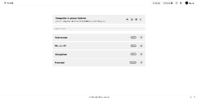
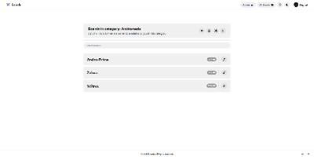
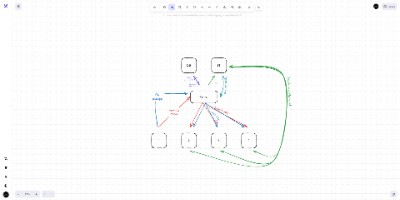
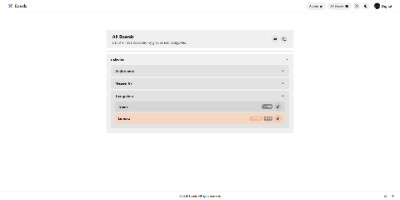
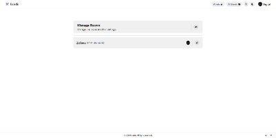
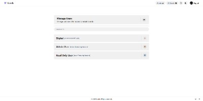

# 📝 Boards App (Frontend)

**Boards App** is a collaborative whiteboard interface built with [Excalidraw](https://github.com/excalidraw/excalidraw). It integrates real-time collaboration, group-based board management, persistent storage, and OAuth login—all backed by the Boards Room backend.

---

## 🚀 Features

- 🧠 Real-time multi-user drawing (Excalidraw)
- 📁 Organization hierarchy: Groups > Categories > Boards > Live Rooms
- 🔐 Admin panel to manage live rooms and users
- 🗝️ Fine-grained user access control (read/write permissions)
- 🙈 Option to hide collaborators if preferred
- 🌗 Dark and light mode themes
- 🔒 OAuth/OIDC login (GitHub, Google, Microsoft, Discord, or any OIDC provider)
- ☁️ S3-based file storage
- 🗃️ PostgreSQL for persistent board and user data

---

## 🖼️ Screenshots

Here are some screenshots showcasing the app interface and key features:

| Group View                                                                        | Category View                                                                              | Board View                                                                         |
| --------------------------------------------------------------------------------- | ------------------------------------------------------------------------------------------ | ---------------------------------------------------------------------------------- |
| [](screenshots/group_view.png) | [](screenshots/category_view.png) | [](screenshots/board_view.png) |

| All-in-One View                                                             | Admin: Rooms                                                                         | Admin: Users                                                                         |
| --------------------------------------------------------------------------- | ------------------------------------------------------------------------------------ | ------------------------------------------------------------------------------------ |
| [](screenshots/all_view.png) | [](screenshots/admin_rooms.png) | [](screenshots/admin_users.png) |

---

## ⚙️ Getting Started

### 1. Clone the repo

```bash
git clone https://github.com/Excali-Boards/boards-app.git
cd boards-app
pnpm install
```

### 2. Configure environment

Create a `.env` file with the following variables:

```env
# Core URLs
BASE_URL="http://localhost:3002"
API_URL="http://localhost:3004"

# Server Configuration
PORT=3002
SESSION_SECRET="your-session-secret"
API_TOKEN="your-api-token"           # Must match backend token

# Optional Features
SHOW_SEARCHES=false
USE_QR_LOGIN=true
TLDRAW_LICENSE=""

# S3 Configuration
S3_URL="https://your-s3-url"
S3_BUCKET="your-s3-bucket"

# Google OAuth
USE_GOOGLE=true
GOOGLE_CLIENT_ID=""
GOOGLE_CLIENT_SECRET=""
GOOGLE_REDIRECT_URI="http://localhost:3002/callback/google"

# GitHub OAuth
USE_GITHUB=true
GITHUB_CLIENT_ID=""
GITHUB_CLIENT_SECRET=""
GITHUB_REDIRECT_URI="http://localhost:3002/callback/github"

# Discord OAuth
USE_DISCORD=false
DISCORD_CLIENT_ID=""
DISCORD_CLIENT_SECRET=""
DISCORD_REDIRECT_URI="http://localhost:3002/callback/discord"

# Microsoft OAuth
USE_MICROSOFT=false
MICROSOFT_CLIENT_ID=""
MICROSOFT_CLIENT_SECRET=""
MICROSOFT_TENANT_ID=""
MICROSOFT_REDIRECT_URI="http://localhost:3002/callback/microsoft"

# Generic OpenID Connect
USE_OIDC=false
OIDC_ISSUER_URL="https://your-provider.example"
OIDC_CLIENT_ID=""
OIDC_CLIENT_SECRET=""
OIDC_DISPLAY_NAME="OpenID Connect"
OIDC_SCOPES="openid profile email"
```

> The OIDC issuer must expose standard discovery metadata at `/.well-known/openid-configuration`. Boards uses `BASE_URL + /callback/oidc` as the callback, so register that exact URL with the provider.

> For [RelayId](https://github.com/RelayId), configure Boards as a downstream `oidc.clients` client and set `OIDC_ISSUER_URL` to RelayId's public base URL. RelayId's `oauth2.providers` are configured in RelayId itself; they are its upstream identity sources, not another Boards provider setting.

### 3. Run the frontend

```bash
pnpm run rebuild
```

Frontend runs at `http://localhost:3002`.

---

## ⌨️ Keyboard Shortcuts

When editing a board (Excalidraw), the following custom keyboard shortcuts are available:

| Shortcut               | Action                     | Description                                                |
| ---------------------- | -------------------------- | ---------------------------------------------------------- |
| `Ctrl/Cmd + Shift + O` | Toggle Hide from View-Only | Toggle visibility of selected elements for view-only users |
| `Ctrl/Cmd + Shift + A` | Enable Auto-Resize         | Enable auto-resize property for selected elements          |

> 💡 **Note:** These shortcuts only work when you have edit permissions on the board and have selected one or more elements.

---

## 🤝 Contributing

Contributions, fixes, and ideas are welcome! If you'd like to get involved:

- Fork the repository and make your changes.
- Run `pnpm lint && pnpm typecheck:once` before pushing.
- Open a pull request with a clear description.

Please follow the existing coding style and commit clean, atomic changes.

---

## 💬 Support

Questions, issues, or just want to chat? Join our community on **Discord**:
👉 [https://discord.gg/4rphpersCa](https://discord.gg/4rphpersCa)

---

## 📜 License

[GNU General Public License v3.0](./LICENSE)
